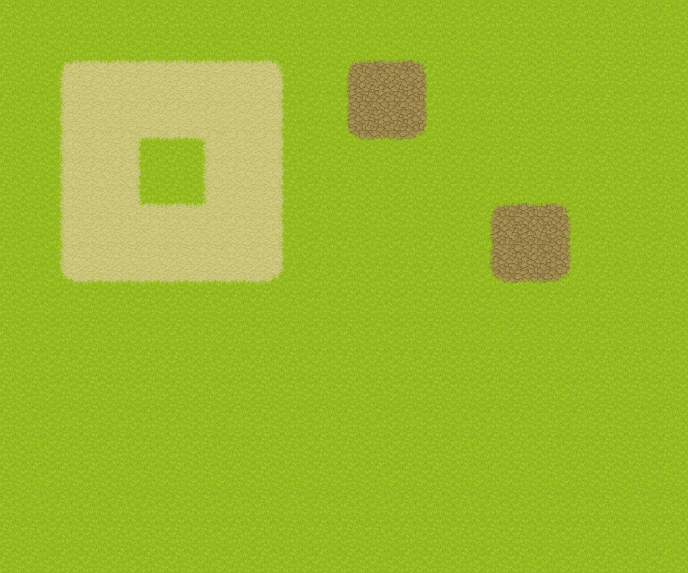

# Advanced guide

[← Back to the README](../README.md)

Manual setup, tool contracts, architecture, limits and development checks.

## Manual installation

Requires Node.js 24+ and Tiled 1.12.2 on macOS or Linux. Native Windows transport is disabled with an explicit error; the alternative is to run Node, the MCP stdio server, and Linux Tiled together inside WSL with WSLg. Do not mix native Windows Tiled with a WSL bridge. Linux/WSL validation of the new transport remains outstanding.

```sh
git clone https://github.com/rpgjs/tiled-ai.git
cd tiled-ai
npm ci
npm run build
node dist/cli.mjs init
node dist/cli.mjs install --extensions "$HOME/.config/tiled/extensions"
```

That path is the Linux default. Use the extensions directory shown in Tiled's preferences on macOS or custom installations. Installation copies the extension and its local configuration. The configuration records an absolute Node executable, the checkout's `dist/relay.mjs`, and a private Unix socket path. Keep that checkout and Node installation available; reinstall the extension after moving either. No reusable bridge secret is generated.

Configure your MCP client with an absolute path, adapting this example to its configuration format:

```json
{
  "mcpServers": {
    "tiled-ai": {
      "command": "node",
      "args": ["/path/to/tiled-ai/dist/cli.mjs", "serve"]
    }
  }
}
```

Start the MCP client and Tiled, open a map and select an area. Use **Map → Tiled AI: Connect** if Tiled is already running. **Disconnect** and **Status** are in the same menu. Reconnect explicitly after a connection loss.

Try: “Inspect the tilesets and build a house in the selected area, with a path to the door and collisions.” The client model must support images to choose tiles visually.

`node dist/cli.mjs doctor` shows the local configuration and private socket paths. Commands accept `--config /path/to/config.json`. `init` creates a dedicated mode-0700 directory under the user's home (named `.tiled-ai-*`); the bridge creates its mode-0600 socket inside. The directory persists across restarts. Each MCP stdio client connects to that same bridge; multiple Tiled instances retain separate editor sessions. Keep the socket path under 100 UTF-8 bytes. Configured paths must be canonical and free of symlinks, with trusted ancestors.

### Migrating a TCP installation

Save work, disconnect/close Tiled, stop existing MCP clients, and terminate the **known old bridge** by its identified PID. Do not use the old `bridge-stop` against an unverified TCP listener: it sends the old bearer credential. New CLI commands and the new extension reject old configurations without contacting that endpoint.

Then rebuild and run:

```sh
node dist/cli.mjs init --migrate --config /path/to/config.json
node dist/cli.mjs install --config /path/to/config.json --extensions /path/to/extensions
node dist/cli.mjs bridge-start --config /path/to/config.json
```

Migration explicitly replaces the old `port`/`token` configuration with version 2 private IPC. Reinstall **every** old extension copy, including project-specific copies, before reopening Tiled; an old extension can still disclose its old token. Remove obsolete configuration copies. Old tokens cannot authorize the new bridge. There is no TCP fallback.

### Multiple Codex tasks and upgrades

`serve` automatically starts one detached `bridge` process when needed. Concurrent clients reuse the private bridge and share its editor sessions, image-import preparation and request deduplication. Closing a Codex task only closes its stdio client, leaving Tiled and other tasks connected. Conflicting edits still require fresh document revisions.

Run `node dist/cli.mjs bridge-start` to start or reuse the shared bridge explicitly; it returns promptly. The bridge stays running after the last client exits. To stop it explicitly, run `node dist/cli.mjs bridge-stop` with the same `--config` if customized. Restart the MCP integration to start it again, then reconnect Tiled explicitly. For startup diagnostics, `node dist/cli.mjs bridge` runs the bridge in the foreground when the socket is absent. No credential or editor payload is passed on the command line.

When upgrading from the original single-client version, stop the old `serve` process that owns the bridge port, rebuild, and restart the MCP integration in Codex. Then use **Tiled AI: Connect**. The new client reports `BRIDGE_INCOMPATIBLE` if an older server or a service with another secret occupies its port. It does not kill that process automatically. After upgrading a running shared bridge, use `bridge-stop` and restart it to load the new code. The existing extension and Codex MCP command remain compatible.

Tiled's **connected** status describes its link to the bridge; it cannot guarantee that a particular Codex task loaded MCP tools. Check the task's MCP integration as well. A new task now reuses the bridge instead of failing with `EADDRINUSE`.

## Image → TSX → TMX → terrain

1. `inspect_tileset_image` accepts an absolute local image path or HTTPS URL, including GitHub `blob` links. It returns dimensions, an image preview and possible grids. With a saved document as context it suggests a `tilesets` directory beside that document. Otherwise the agent asks for a destination.
2. `create_tileset_from_image` requires explicit grid dimensions, margin, spacing, name and absolute TSX output path. It imports the image next to the TSX, writes a relative image reference through Tiled's TSX writer, and opens the new tileset. Existing TSX files are never intentionally overwritten.
3. Inspect annotated pages with `get_tileset_images`, then use `create_wang_set` or `update_wang_set`. Edge, corner and mixed definitions use eight indices in Tiled order: top, top-right, right, bottom-right, bottom, bottom-left, left, top-left. Zero means no terrain; colors are numbered from one. Definitions and tile references are validated before editing.
4. If no map exists, `create_map` creates and opens a new TMX with explicit cell dimensions, tile dimensions and destination. It writes the initial blank map and refuses an existing destination. Then `attach_tileset` attaches an open tileset to the target map with a revision check and map Undo. `paint_terrain` prepares tiles with Tiled's Wang engine, validates the generated cells and applies one map Undo macro. Use `list_wang_sets` to obtain live IDs.
5. Verify the affected region and `get_region_image`. Use `save_tileset` and `save_map` when saving is requested. Map painting never saves the map automatically. Save external tilesets separately before sharing the TMX.

The exact [Grass example image](../examples/grass/ATTRIBUTION.md) has a verified `pipoya-grass-48` profile: 32 × 32 cells in eleven blocks of 48 tiles. Recognition requires the image's SHA-256, not its name or dimensions alone. Other images receive grid candidates, not invented terrain assignments. An agent must inspect centers, edges and corners and ask a focused question when the evidence is ambiguous. Metadata generation does not create pixels or guarantee that an arbitrary image contains a complete terrain.



### Creating and saving maps

`create_map` requires `sessionId`, a unique `requestId`, an absolute `.tmx` `outputPath`, `width`/`height` in cells and `tileWidth`/`tileHeight` in pixels. It defaults to an orthogonal finite map with one `Ground` tile layer. Supply `layers` to choose initial tile layer names, `orientation` and `infinite` as needed. Staggered/hexagonal maps accept `staggerAxis` and `staggerIndex`; hexagonal maps require a positive `hexSideLength` bounded by the tile dimension on that axis. Initial dimensions are limited to 1,048,576 cells and 4,096 per axis.

The initial blank TMX is saved and opened; subsequent editing stays unsaved until requested. Creation returns `fileCreated`, `documentOpened`, `documentId` and a revision. File creation is not an Undo operation. If opening fails after writing, recover with `open_map` instead of recreating the file.

`save_map` takes the target document, fresh revision and unique request ID. With no `outputPath`, it saves the map's associated TMX and keeps the live document and Undo history. An optional different absolute `.tmx` path writes a new copy and refuses an existing file. This copy does **not** retarget the live document or clear its modified flag; the result reports `savedCopy`, `documentFilePath` and `modified`. This also allows exporting an untitled map. `open_map` opens that copy if needed. Saving a map does not save its external tilesets, and Undo does not revert a disk write.

### Terrain limitations

The painter supports square-cell Wang topology on orthogonal and isometric maps. Staggered and hexagonal maps return `UNSUPPORTED_TERRAIN_ORIENTATION` before mutation. Ordinary tile and object tools support all four orientations. Transformed neighboring terrain tiles require an explicit transformed definition and are currently rejected by the painter.

Painting takes a footprint of cells, intersected with the exact active selection. It preserves neighbors and rejects a boundary that would require editing outside that footprint. Missing patterns produce `MISSING_WANG_PATTERN`; a one-cell island is not possible with the supplied Grass profile. Variants may share a Wang ID. Tiled chooses among matching variants; the bridge verifies its result before applying it.

**Tiled 1.12.2 workaround:** native terrain-color renaming after increasing the color count can crash Redo. The extension stores names in the undoable `tiled-ai:terrain-names` Wang-set property. MCP returns those names immediately. Explicit `save_tileset` exports them to standard TSX color names; reopen the TSX to see updated native color labels. Ordinary Tiled Save preserves the property but may retain old native labels. The tileset Undo history remains usable until the document is closed. `save_tileset` currently supports TSX destinations only. The regression is exercised by the real integration test; the relevant native commands are [color count changes](https://github.com/mapeditor/tiled/blob/v1.12.2/src/tiled/changewangsetdata.cpp) and [color name changes](https://github.com/mapeditor/tiled/blob/v1.12.2/src/tiled/changewangcolordata.cpp).

## Architecture and guarantees

```text
AI clients → separate MCP stdio clients → shared local bridge → .mjs extension → Tiled API
```

- `packages/protocol`: shared Zod schemas, types, limits and errors.
- `packages/extension`: live documents, validation, editing, rendering and Undo.
- `packages/server`: MCP server, local bridge, request deduplication and annotated image sheets.

The extension targets ES2016 for Tiled's Qt engine. Tiled's [Process API](https://www.mapeditor.org/docs/scripting/classes/Process.html) runs the installed Node relay for each request through anonymous stdin/stdout pipes. The helper carries HTTP over a private Unix socket; no TCP listener is used. Qt deferred callbacks check child completion with waits bounded to 5 ms, rather than blocking for the 20-second long poll. This adds a Node process launch per request. The relay enforces a 40-second network deadline and 32 MiB messages; the extension has a 45-second child deadline. Disconnect kills pending children.

Filesystem access authenticates both peers against other OS users. Every connection validates directory ownership, mode 0700, trusted non-symlink ancestors, and an owned private socket. Health sends no credential. Origin headers and legacy Authorization headers are rejected. A recorded old bearer or HTTP body cannot grant another user access to the protected endpoint. Processes running as the same user, administrators, and changes to filesystem ACLs are outside this isolation boundary. No arbitrary JavaScript or shell execution tool is exposed, but editor/file capabilities remain broad; this is not project filesystem confinement.

Normal shutdown removes the socket. A crash can leave it behind: `BRIDGE_STALE_SOCKET` fails closed, and startup never unlinks an existing endpoint. Stop clients, verify that no bridge owns the endpoint, then manually remove **only the stale socket** and restart. Do not remove the private directory or a live listener. Symlinks, permissive directories and unexpected files are errors, not cleanup targets. `BRIDGE_INCOMPATIBLE` means an unexpected service is responding on the private endpoint; identify it before stopping anything.

Document edits require a session ID, document ID, unique request ID and revision from `get_map_info`. Revisions include live content, selection and Wang definitions. References are checked before starting an Undo macro. Batch references resolve against the initial state; create layers before a batch that uses them. External tilesets have their own document and Undo history.

Tile coordinates are integer cells; object coordinates follow Tiled's native orientation conventions. Disjoint selections retain their exact mask. Tile operations refuse writes outside the active selection rather than relying on Tiled's silent clipping.

After a lost response, inspect `get_request_status`. A dispatched request may already have applied. Identical retries are deduplicated within the running session; a different payload cannot reuse its ID. Reconnecting the same extension can recover its cached result. After a shared bridge or extension restart, inspect documents and files before deciding what remains. TSX creation reports `fileCreated` and `documentOpened`; attachment is a separate request. Recover an existing TSX with `open_tileset`, then check whether it is already attached. Use `open_map` for an existing TMX. A staged image may remain after failed creation. Do not blindly repeat a file creation or mutation.

Unexpected native edit errors report completed operations and whether the failing operation may have changed the document. File saving is explicit and is not undone by document Undo.

Limits: 16,384 cells per region/batch; 256 data items or 64 tile images per page; revision inspection of at most 1,048,576 occupied-region cells; at most 32 retained revisions with earlier eviction to bound memory. Image imports are limited to 16 MiB and 16 megapixels, using non-animated PNG, JPEG or WebP. Custom class/enum properties are readable but not writable. Structures accept tiles and unrotated geometric objects; ordinary object tools also support text, tile objects and rotation.

See the [tool reference](../skills/tiled-ai/references/tools.md) and [terrain workflow](../skills/tiled-ai/references/terrain.md).

## Companion skill

```sh
npx skills add . --skill tiled-ai
```

The [tiled-ai skill](../skills/tiled-ai/SKILL.md) guides inspection, visual tile choice, grid recognition, TSX/Wang creation, bounded painting and recovery. It contains no model. When prerequisites are missing, its [setup workflow](../skills/tiled-ai/references/setup.md) guides an agent with local shell access to install the extension, configure MCP and start the bridge. The Skills CLI itself only installs instructions. Reloading Tiled or the client may still require a manual action.

Install the published skill with `npx skills add rpgjs/tiled-ai --skill tiled-ai`. The setup scripts do not publish anything.

## Examples and validation

```sh
npm run demo:assets
npm run demo:grass:assets
npm run check
# Includes the concurrent MCP client regression test
npm run test:tiled
npm run test:terrain
# Explicitly regenerate the saved examples:
node scripts/test-tiled.mjs --terrain --demo
```

Tests resolve `TILED_APPIMAGE` first, then `tiled` from `PATH`, and fail clearly when neither is available:

```sh
TILED_APPIMAGE=/path/to/Tiled.AppImage npm run test:terrain
# On Linux without a display:
xvfb-run -a npm run test:terrain
```

Real integration tests launch Tiled and an MCP client with isolated configuration, data and cache under `.tmp`. Test-only editor controls are never shipped in the extension. They verify live edits, revision conflicts, lost responses, Undo/Redo, file creation/reopening, terrain boundaries, holes and negative coordinates. Unsupported terrain orientations are tested as explicit errors.

The house uses [start.tmx](../examples/rpgjs/start.tmx), [house.tmx](../examples/rpgjs/house.tmx) and the deterministic recipe in `scripts/house.mjs`. The Grass example is generated from its PNG alone; the companion source TSX is read only as an independent test oracle after generation. Generated assets are in [examples/grass](../examples/grass), including the TSX, map, preview and pinned source hashes. See [house attribution](../examples/rpgjs/ATTRIBUTION.md), [Grass attribution](../examples/grass/ATTRIBUTION.md) and the [real Tiled test report](../examples/rpgjs/validation.json).

`npm run check:public` scans distributable files for personal paths, credential patterns and accidentally included runtime files. `.tmp`, dependencies and build outputs are excluded; tracked files are also checked when Git is available. This is a targeted accidental-disclosure check, not a guarantee that all secrets can be recognized. Keep runtime configurations, environment files, logs and private keys out of Git.

### Private IPC verification

`npm run check` includes unsafe-path, impostor TCP, legacy-token, stale/live socket, migration, and shared-MCP lifecycle regressions. `TILED_APPIMAGE=/path/to/Tiled npm run test:ipc:tiled` runs the bundled extension and relay in the real Tiled runtime with temporary configuration. It suppresses only Map-menu registration because `--evaluate` has no Map menu, and uses a dialog to keep Qt's event loop alive. This checks connect, polling/replies, same-session reconnect, and explicit shutdown; it does not establish full GUI editing coverage.

The transport was exercised on macOS with Tiled 1.12.2 and Node 26.10.0. Linux, WSL/WSLg, and an actual second-OS-user connection attempt remain unverified; tests check the ownership/mode enforcement and fail-closed behavior. The pre-existing full editor suite remains available via `npm run test:tiled` on Linux.
